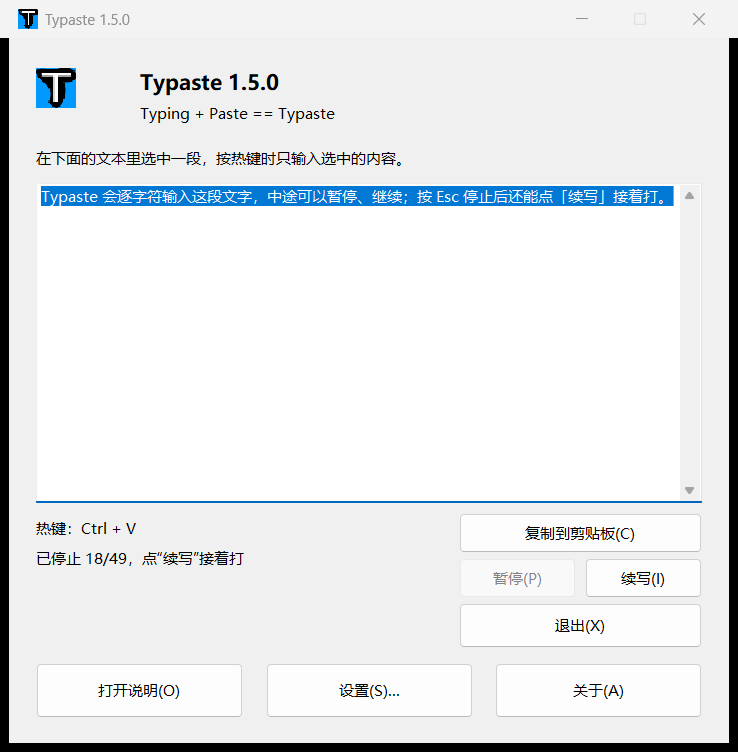

#  Typaste

Typing + Paste == Typaste.



Typaste intercepts the pasting process by Ctrl+V while its window is displayed
and emulates the text input as if it were typed on the keyboard. This allows you
to break through the "paste prohibition".

Press the Esc key to stop typing.

## Features

- Types any clipboard text character by character, like a human would
- **CJK and emoji work**: characters that the keyboard layout cannot produce are
  sent as Unicode input (`SendInput` + `KEYEVENTF_UNICODE`), not as `WM_CHAR`
- Typing runs on a worker thread, so the window stays responsive
- Configurable typing delay / start delay / random interval
- Global hot-key (Ctrl+V by default), optional IME on/off control
- Optional typing sound
- Four UI languages: English, Japanese, Simplified Chinese, Traditional Chinese
- High-DPI aware, modern dialog layout, About box, one-click reset to defaults
- Tray icon with a context menu; the window minimizes to the notification area
- **Program whitelist**: intercept Ctrl+V only in the programs you choose
- Per-Monitor V2 DPI awareness (crisp on every monitor)
- CI builds for x64 and Win32, optional Authenticode signing
- Single instance, settings stored in `HKCU\SOFTWARE\Katayama Hirofumi MZ\Typaste`

## Download

Grab the latest x64 build from the
[Releases](https://github.com/YHuanheg/Typaste/releases) page.

## Supported Platforms

- Windows Vista / 7 / 8.1 / 10 / 11, **x64** (primary target)
- The legacy Win32 (x86) build is still supported

## Languages

"Follow the system" keeps the UI in the language of Windows. To pick a language
explicitly, open **Settings...** and choose it in **Interface language**. The
change takes effect immediately.

## Building

With Visual Studio / MSVC (CMake 3.15+):

```
cmake -S . -B build-x64 -A x64 -DCMAKE_BUILD_TYPE=Release
cmake --build build-x64 --config Release
```

`-A x64` is the default: the project selects it when the generator is MSVC.
Without CMake, run `build_x64.bat`: it produces `build-x64\Typaste.exe` with the
static CRT and the same hardening flags.

The localized resources are generated from a single layout by
`python tools/gen_lang.py`. Run `tools\verify_lang.bat` to check that all four
languages made it into the binary.

## Credits

- Original author: **Katayama Hirofumi MZ** (katahiromz)
- Maintainer: **YHuanheg** — https://github.com/YHuanheg

## License

MIT License. See [LICENSE.txt](LICENSE.txt).

## Warning

Please do not use this software for illegal purposes.
